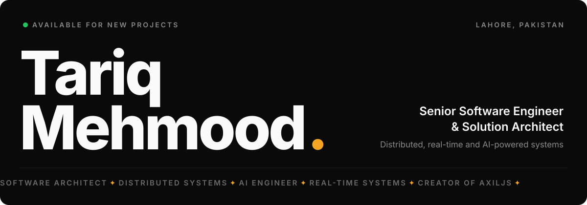

<a href="https://www.tariq-mehmood.online">
  
</a>

<p align="center">
  <a href="https://www.tariq-mehmood.online"><b>Portfolio</b></a> &nbsp;·&nbsp;
  <a href="https://www.tariq-mehmood.online/work">Case studies</a> &nbsp;·&nbsp;
  <a href="https://www.tariq-mehmood.online/resume">Resume</a> &nbsp;·&nbsp;
  <a href="https://www.linkedin.com/in/tar-me/">LinkedIn</a> &nbsp;·&nbsp;
  <a href="https://www.axiljs.dev/">AxilJS</a> &nbsp;·&nbsp;
  <a href="https://github.com/SyntaxilitY">SyntaxilitY</a> &nbsp;·&nbsp;
  <a href="https://www.youtube.com/@SyntaxilitY">YouTube</a> &nbsp;·&nbsp;
  <a href="https://leetcode.com/u/TariqMehmood1004/">LeetCode</a> &nbsp;·&nbsp;
  <a href="mailto:tariq-mehmood@engineer.com">Email</a>
</p>

<br />

### Architecture that ships.

I design and build **distributed, real-time and AI-powered systems**, from architecture and system design through implementation, deployment and production operations.

I have 9+ years of hands-on experience since 2017, designing enterprise, multi-tenant SaaS, event-driven and AI systems. My core is backend and architecture: **Node.js, TypeScript, Python, ASP.NET Core, PostgreSQL, Redis, RabbitMQ and Kafka**, deployed on **AWS, Docker and CI/CD**, with React and Next.js on the front. I also build my own tools, like the [AxilJS](https://www.axiljs.dev/) backend ecosystem.

<table>
  <tr>
    <td align="center" width="20%"><h2>9+</h2><sub>YEARS IN PRODUCTION</sub></td>
    <td align="center" width="20%"><h2>100+</h2><sub>CLIENT PROJECTS DELIVERED</sub></td>
    <td align="center" width="20%"><h2>85%</h2><sub>DOWNTIME CUT, SMART BUILDING</sub></td>
    <td align="center" width="20%"><h2>8+</h2><sub>ENGINEERS LED</sub></td>
    <td align="center" width="20%"><h2>19</h2><sub>NPM PACKAGES PUBLISHED</sub></td>
  </tr>
</table>

<br />

## Now

<sub>Updated October 2026 &nbsp;·&nbsp; <a href="https://www.tariq-mehmood.online/now">tariq-mehmood.online/now</a></sub>

1. **Architecting an enterprise manufacturing platform:** event-driven microservices for product lifecycle, production planning and ERP workflows, with the data layer prepared for device telemetry and AI-assisted planning.
2. **Growing AxilJS:** expanding the `@axiljs` packages with AI and agent support, observability, multi-tenancy and the dev studio.
3. **Shipping the SyntaxilitY Media Player:** iterating on playback modes, lyrics and media-driven theming.
4. **Open to the next role:** senior engineering, architecture and AI engineering, full-time, contract or remote.

<br />

## Systems I've Architected

Nine platforms across enterprise manufacturing, multi-agent AI, defense, commerce and payments, real-time and open source. Each case study on my portfolio includes an interactive architecture diagram.

| | System | Role | Highlights | |
| :-- | :-- | :-- | :-- | :-- |
| 01 | **Enterprise Manufacturing Platform** | Solution Architect | PLM / MES event-driven microservices, ERP integration layer, telemetry-ready. `.NET` `PostgreSQL` `Redis` | [Case study](https://www.tariq-mehmood.online/work/current-role) |
| 02 | **[Tygent](https://tygent.vercel.app/)**: Multi-Agent Recruitment AI | Creator & Architect | 8 orchestrated agents, live SSE streaming, LLM model fallback. `Next.js` `OpenAI` `Drizzle` | [Case study](https://www.tariq-mehmood.online/work/tygent) · [Demo](https://tinyurl.com/bdvrnmxn) |
| 03 | **[Enterprise Commerce & Payments](https://hk.swiftnine.com/)** | Senior Software Engineer | Multi-tenant backend for Shopify / WooCommerce, cross-store checkout, 4 payment providers. `Node.js` `Stripe` `Adyen` | [Case study](https://www.tariq-mehmood.online/work/commerce-payments) |
| 04 | **[AxilJS](https://www.axiljs.dev/)**: Backend Ecosystem | Creator & Architect | Modular TypeScript backend toolkit, 19 npm packages. `TypeScript` `Node.js` `Kafka` | [Case study](https://www.tariq-mehmood.online/work/axiljs) |
| 05 | **Smart Building Automation**: Pakistan Air Force | Senior Software Engineer | 16+ subsystems in real time, millions of requests, AI anomaly detection, 85% less downtime. `Node.js` `Python` `Kafka` | [Case study](https://www.tariq-mehmood.online/work/smart-building) · [Demo](https://tinyurl.com/43b237jc) |
| 06 | **[Emergi Mentors](https://emergimentors.com.au/)** | Technical Lead & Architect | Mentoring platform with live video and AI features, 8+ engineer team. `FastAPI` `Laravel` `PostgreSQL` | [Case study](https://www.tariq-mehmood.online/work/emergi-mentors) |
| 07 | **[Casinoze](https://casinoze.com/)**: Real-Time Gaming | Backend Lead | DRF APIs, WebSocket live events, Celery workers. `Django` `Redis` `PostgreSQL` | [Case study](https://www.tariq-mehmood.online/work/casinoze) |
| 08 | **Odoo Automation System** | Senior Software Engineer | Custom Odoo 19 modules, WhatsApp Cloud API lead capture, multi-company. `Odoo` `Python` `AWS` | [Case study](https://www.tariq-mehmood.online/work/swiftnine-odoo) |
| 09 | **[SyntaxilitY Media Player](https://syntaxility.vercel.app/)** | Creator & Architect | Electron desktop player with adaptive theming and mini / floating modes. `Electron` `React` `Zustand` | [Case study](https://www.tariq-mehmood.online/work/media-player) |

<br />

## Open Source: AxilJS

[AxilJS](https://www.axiljs.dev/) is my modular TypeScript backend ecosystem: the infrastructure I kept rebuilding on every project, packaged once and published to npm.

<p>
  <a href="https://www.npmjs.com/org/axiljs"></a>
  <a href="https://www.npmjs.com/org/axiljs"></a>
  <a href="https://github.com/SyntaxilitY/AxilJS"></a>
</p>

```ts
import { Application } from '@axiljs/core'

const app = new Application()

app.get('/users', (req, res) => res.success(users, 'Users fetched'))
app.post('/users', (req, res) => res.created(req.body, 'User created'))

app.listen()
```

| Package | Purpose | Package | Purpose |
| :-- | :-- | :-- | :-- |
| `@axiljs/core` | HTTP server, router, middleware | `@axiljs/queue` | Message queue, cron, retry with backoff |
| `@axiljs/orm` | PostgreSQL, MySQL, SQLite, migrations | `@axiljs/events` | Pub/sub event bus |
| `@axiljs/auth` | JWT, password hashing, RBAC | `@axiljs/circuit` | Circuit breaker, retries, timeouts |
| `@axiljs/security` | Helmet, rate limiting, CSRF, sanitization | `@axiljs/ai` | OpenAI, Anthropic, Gemini, Ollama, RAG, agents, MCP |
| `@axiljs/validation` | Schema-based request validation | `@axiljs/observability` | Logs, Prometheus metrics, tracing |
| `@axiljs/websocket` | RFC 6455 server with rooms | `@axiljs/cloud` | Multi-tenancy, audit logs, feature flags |
| `@axiljs/testing` | Test runner and HTTP test client | `@axiljs/cli` | `axil create`, `run`, `build`, `test`, `deploy` |

**Also built:** [Tumigo](https://www.tariq-mehmood.online/tumigo), a Python-based programming language.

<br />

## More Live Work

| Project | Description |
| :-- | :-- |
| [Code Arena](https://codearena-woad-seven.vercel.app/) | Production-grade SaaS for live coding interviews, technical assessments and collaborative programming sessions. |
| [Faagent](https://migentic.vercel.app/) | Micro-agentic AI system built from many small, narrowly scoped agents instead of one general-purpose agent. |
| ImageForge AI | Modular engine for programmatic image generation across OpenAI, Stability AI, Replicate and local models. |
| SyntaxilitY AI CLI | Command-line tool that generates professional app icons from natural-language descriptions. |
| [RecipeNine AI](https://apps.apple.com/ae/app/recipenine-ai/id6760646769) | AI recipe app built with React Native and Expo, live on the App Store. |

<br />

## What I Do Best

| Discipline | Toolkit |
| :-- | :-- |
| **Solution Architecture & System Design** | Microservices, modular monoliths, multi-tenant SaaS, SOA, MVC / MVVM / MVT, database and API design |
| **Backend Engineering & APIs** | Node.js, Express, TypeScript, Python, FastAPI, Django, ASP.NET Core, Prisma, Drizzle, REST, OpenAPI, JWT, OAuth 2.0, RBAC |
| **Event-Driven & Real-Time Systems** | Apache Kafka, RabbitMQ, Redis, Celery, WebSockets, Socket.IO, SSE, clustering, worker threads |
| **AI Engineering** | LLMs, multi-agent orchestration, RAG, LangChain, OpenAI, Claude, NLP, computer vision, anomaly detection |
| **Enterprise & Payment Integrations** | SAP Business One, Odoo 19, WhatsApp Cloud API, Shopify, WooCommerce, Stripe, PayPal, Adyen, OceanPayment |
| **Cloud, DevOps & Delivery** | AWS (EC2, S3, RDS), Docker, Kubernetes, Nginx, Linux, GitHub Actions, unit and integration testing |
| **Full-Stack, Desktop & Mobile** | React, Next.js, Redux Toolkit, Zustand, Tailwind CSS, Electron, React Native, Flutter |

<p>
  
</p>

<br />

## Experience

| Period | Role | Company |
| :-- | :-- | :-- |
| Sep 2026 – Present | Senior Software Engineer & Solution Architect | Enterprise manufacturing platform |
| Mar 2026 – Aug 2026 | Senior Software Engineer | SwiftNine LLC |
| Aug 2025 – Mar 2026 | Senior Software Engineer (Contract) | Hyetel X, Pakistan Air Force |
| Mar 2025 – Aug 2025 | Senior Technical Team Lead (Contract) | LCI Systems |
| Sep 2024 – Apr 2025 | Senior Full Stack Developer (Contract) | Dark Bytes |
| Jan 2024 – Dec 2024 | Full Stack Developer (Contract) | MTech Soft LLC |
| Feb 2020 – Nov 2023 | Full Stack Developer | INSTACOM (ISP) |
| Feb 2017 – Aug 2025 | Full Stack Engineer (Freelance) | Upwork, Freelancer, Fiverr |

**Education:** BS Software Engineering, COMSATS University Islamabad, Vehari Campus (2020 – 2024)

<br />

## GitHub Activity

<p align="center">
  
</p>
<p align="center">
  
  
</p>
<p align="center">
  
  
</p>

<br />

## Let's Build Something Great Together

Open to **Senior Software Engineering, Software and Solutions Architecture, AI Engineering, Backend Engineering and Technical Leadership** roles: full-time, contract or remote.

**[tariq-mehmood@engineer.com](mailto:tariq-mehmood@engineer.com)** &nbsp;·&nbsp; [Online resume](https://www.tariq-mehmood.online/resume) &nbsp;·&nbsp; [2-minute video intro](https://tinyurl.com/ywpp6u49) &nbsp;·&nbsp; [LinkedIn](https://www.linkedin.com/in/tar-me/)
