<a href="https://www.tariq-mehmood.online">
  
</a>

<p align="center">
  <a href="https://www.tariq-mehmood.online"><b>Portfolio</b></a> &nbsp;·&nbsp;
  <a href="https://www.tariq-mehmood.online/work">Case studies</a> &nbsp;·&nbsp;
  <a href="https://www.tariq-mehmood.online/resume">Resume</a> &nbsp;·&nbsp;
  <a href="https://www.linkedin.com/in/tar-me/">LinkedIn</a> &nbsp;·&nbsp;
  <a href="https://www.axiljs.dev/">AxilJS</a> &nbsp;·&nbsp;
  <a href="https://github.com/SyntaxilitY">SyntaxilitY</a> &nbsp;·&nbsp;
  <a href="https://www.youtube.com/@SyntaxilitY">YouTube</a> &nbsp;·&nbsp;
  <a href="https://leetcode.com/u/TariqMehmood1004/">LeetCode</a>
</p>

<br />

### Architecture that ships.

I design and build **distributed, real-time and AI-powered systems**, from architecture and system design through implementation, deployment and production operations. My core is backend and architecture: Node.js, TypeScript, Python, ASP.NET Core, PostgreSQL, Redis, RabbitMQ and Kafka, deployed on AWS, Docker and CI/CD, with React and Next.js on the front.

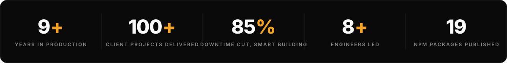

<br />

## Systems I've architected

Every card opens a full case study with an interactive architecture diagram.

<p align="center">
  <a href="https://www.tariq-mehmood.online/work/current-role">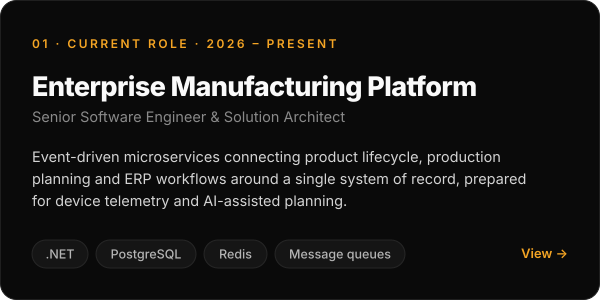</a>
  <a href="https://www.tariq-mehmood.online/work/tygent">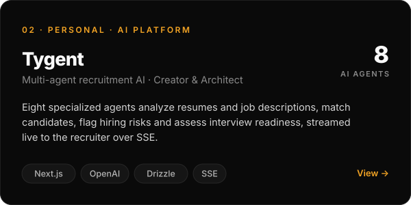</a>
  <a href="https://www.tariq-mehmood.online/work/commerce-payments">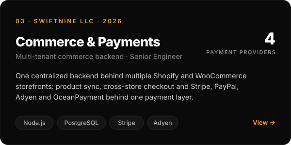</a>
  <a href="https://www.tariq-mehmood.online/work/axiljs">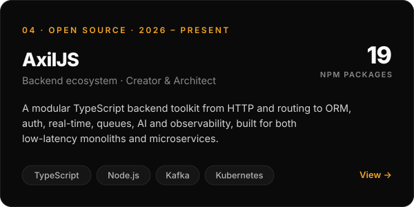</a>
  <a href="https://www.tariq-mehmood.online/work/smart-building">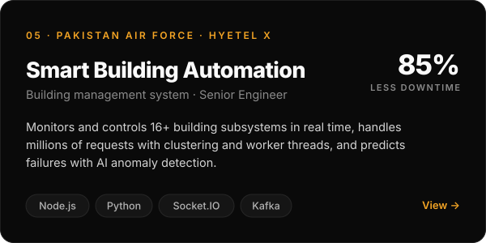</a>
  <a href="https://www.tariq-mehmood.online/work/emergi-mentors">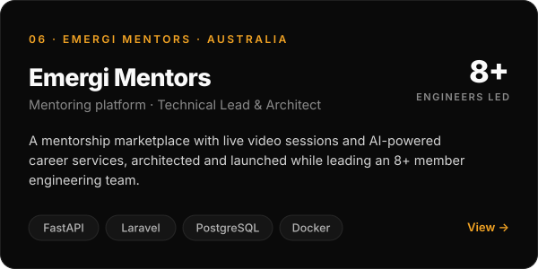</a>
  <a href="https://www.tariq-mehmood.online/work/casinoze">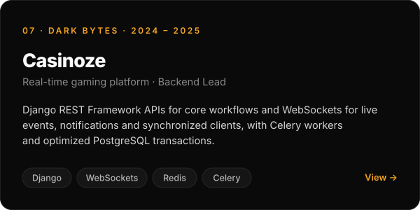</a>
  <a href="https://www.tariq-mehmood.online/work/media-player">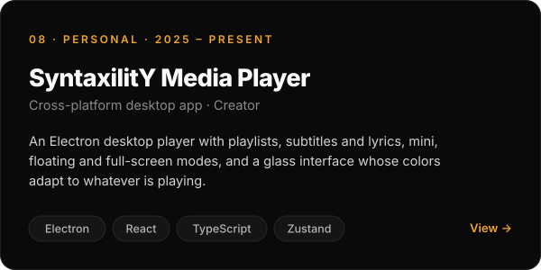</a>
</p>

**Live:** [Tygent](https://tygent.vercel.app/) · [Tygent demo](https://tinyurl.com/bdvrnmxn) · [Code Arena](https://codearena-woad-seven.vercel.app/) · [Faagent](https://migentic.vercel.app/) · [SyntaxilitY](https://syntaxility.vercel.app/) · [RecipeNine AI](https://apps.apple.com/ae/app/recipenine-ai/id6760646769) · [Emergi Mentors](https://emergimentors.com.au/) · [Tumigo language](https://www.tariq-mehmood.online/tumigo)

<br />

## Open source

<a href="https://www.axiljs.dev/">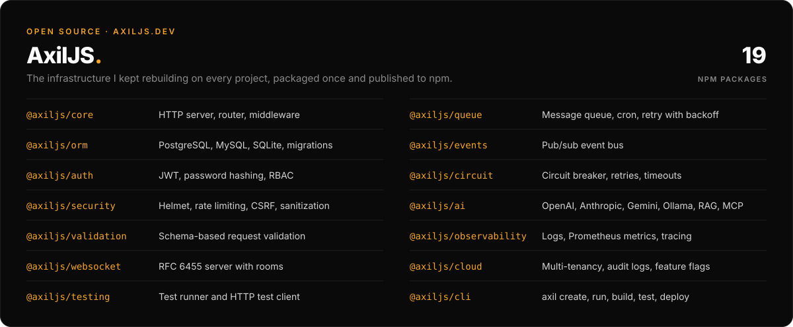</a>

```ts
import { Application } from '@axiljs/core'

const app = new Application()

app.get('/users', (req, res) => res.success(users, 'Users fetched'))
app.post('/users', (req, res) => res.created(req.body, 'User created'))

app.listen()
```

<p>
  <a href="https://www.npmjs.com/org/axiljs"></a>
  <a href="https://www.npmjs.com/org/axiljs"></a>
  <a href="https://github.com/SyntaxilitY/AxilJS"></a>
</p>

<br />

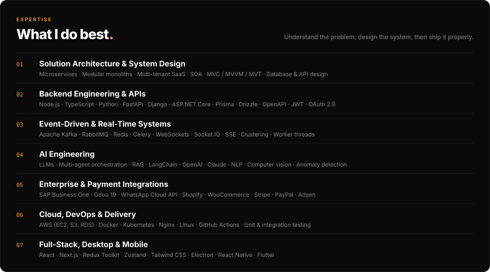

<br /><br />

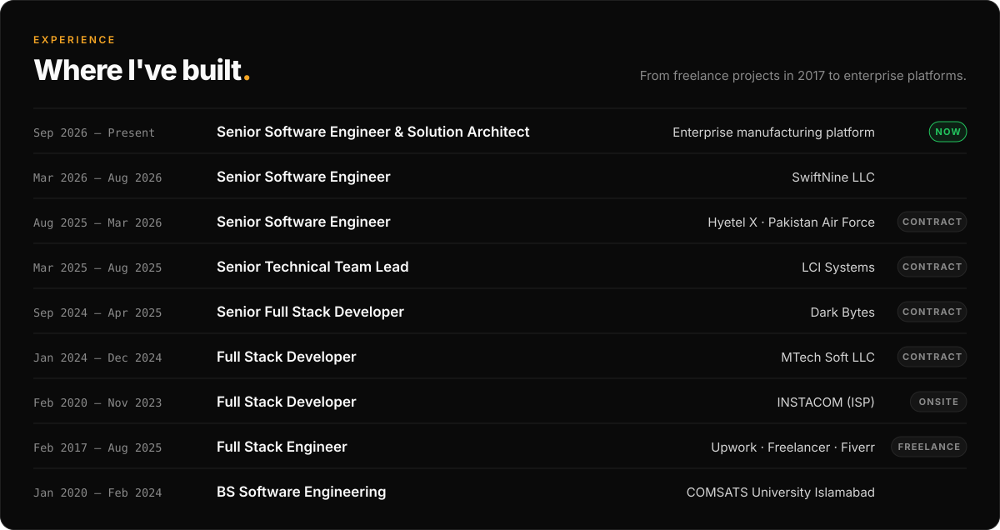

<br /><br />

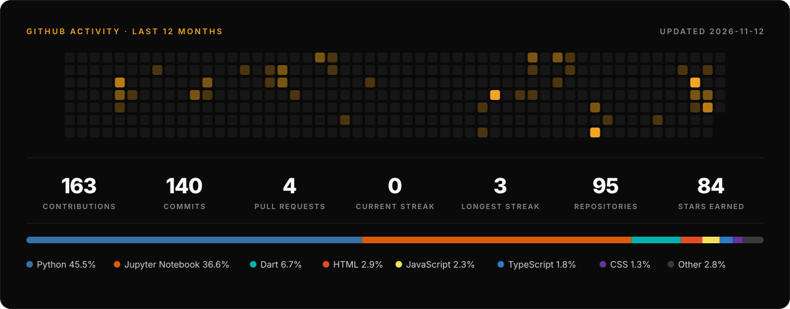

<br /><br />

<a href="mailto:tariq-mehmood@engineer.com">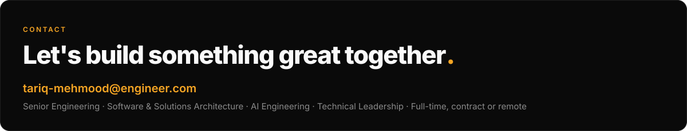</a>

<p align="center">
  <a href="mailto:tariq-mehmood@engineer.com">Email</a> &nbsp;·&nbsp;
  <a href="https://www.tariq-mehmood.online/resume">Online resume</a> &nbsp;·&nbsp;
  <a href="https://tinyurl.com/ywpp6u49">2-minute video intro</a> &nbsp;·&nbsp;
  <a href="https://www.linkedin.com/in/tar-me/">LinkedIn</a>
</p>
